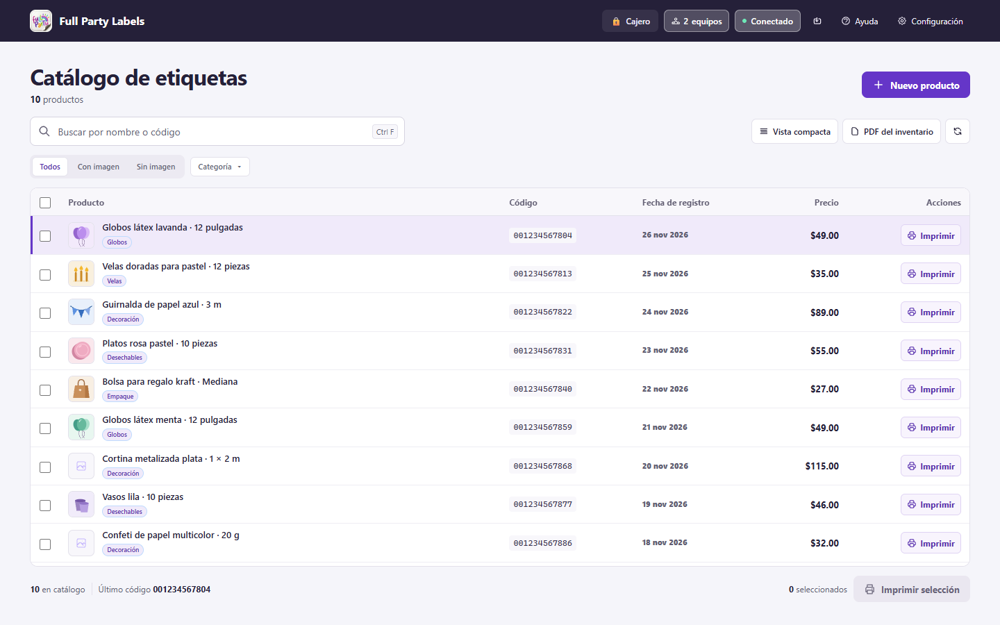
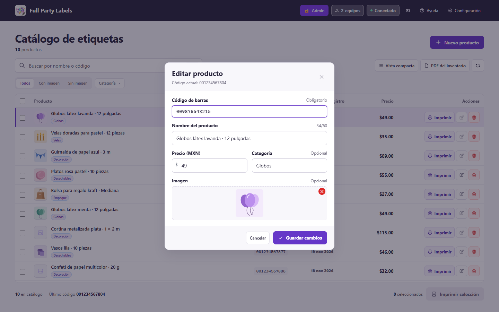
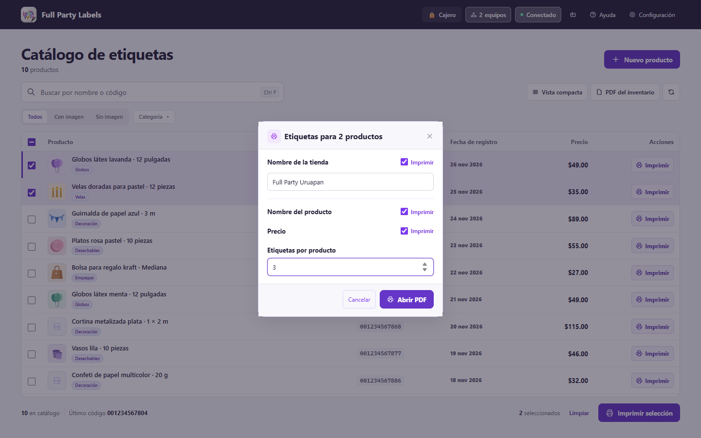

<div align="center">

# Full Party Labels

**Sistema de etiquetas con código de barras para tiendas Full Party**


</div>

[Versión estable](https://github.com/riantorres1975/fullparty-labels-releases/releases/latest) · [Cómo instalar](#instalar-en-otra-pc)

El proyecto de escritorio y su historial de cambios están en el repositorio de desarrollo. [Código fuente de Full Party Labels](https://github.com/riantorres1975/fullparty-etiquetas-supabase)

---

## Qué resuelve

Full Party Labels ayuda a gestionar productos que llegan sin código de barras o con códigos duplicados de fábrica. Puede generar un EAN-13 único, sincroniza el catálogo entre sucursales con Supabase y genera etiquetas PDF de 62 × 29 mm para la Brother QL-800.

La aplicación de escritorio usa Electron, un servidor local FastAPI y un catálogo almacenado en Supabase PostgreSQL.

## Novedades en la versión 2.7.0

La versión estable 2.7.1 incluye estas mejoras y corrige el error de arranque del instalador de la 2.7.0 en Windows de 64 bits. [Notas de la versión 2.7.1](https://github.com/riantorres1975/fullparty-labels-releases/releases/tag/v2.7.1)

- Busca por nombre o código y filtra por categoría o disponibilidad de imagen. La búsqueda admite nombres sin acentos y distintas formas de escribir las medidas. Si ingresas un código de barras completo de 8, 12 o 13 dígitos, busca una coincidencia exacta.
- En modo **Admin**, abre **Editar producto**, escribe o escanea el nuevo código y selecciona **Guardar cambios**. La app necesita conexión para verificar que el código esté disponible.
- Imprime desde la fila del producto o marca varios y elige **Imprimir selección**. La selección se conserva al cambiar de búsqueda o de página y las etiquetas mantienen el código registrado, incluidos los ceros iniciales.
- Al cambiar de página, la app puede mostrar los productos disponibles en la copia local mientras consulta el servidor. También reutiliza las miniaturas guardadas y actualiza los registros que cambiaron en el catálogo local.

## Capturas de la interfaz

Capturas de la versión 2.7.0 con productos de demostración.

### Catálogo de etiquetas



### Edición de código de barras



### Impresión por lote



---

## Stack

| Capa | Tecnologia |
|------|------------|
| Desktop | Electron 28 + HTML + CSS + JS |
| Frontend | Vanilla JS modular |
| Backend local | FastAPI + SQLAlchemy |
| Python | 3.12 recomendado |
| Base de datos | Supabase PostgreSQL |
| Storage | Supabase Storage (`product-images`) |
| Etiquetas | ReportLab |
| Tests | pytest + Vitest |
| Lint | Ruff + ESLint |
| Distribucion | electron-builder + electron-updater |

---

## Cambios Recientes Importantes

- API local protegida con token temporal `X-Fullparty-Token` entre Electron y FastAPI.
- CORS restringido para evitar acceso abierto desde cualquier origen.
- `preload.js` expone solo APIs especificas, no `shell`/`fs` genericos al renderer.
- Productos con endpoint paginado `/products/page` para busqueda y filtros desde backend.
- Navegacion de productos con teclado: flechas, `Home`, `End`, `Espacio`, `Enter` y `Ctrl+P`.
- Migraciones movidas a `backend/migrations.py`.
- Dependencias de desarrollo fijadas en `requirements-dev.txt`.
- Utilidades frontend compartidas en `js/modules/shared-utils.js` y probadas con Vitest.
- Cola offline guarda `operationId`, `attempts` y `lastError`.
- `backend/servidor_etiquetas.exe` ya no se trackea en git; se genera al publicar.

---

## Estructura

```text
fullparty-etiquetas/
|-- main.js                    # Electron main process y arranque del backend
|-- preload.js                 # contextBridge seguro
|-- index.html                 # UI principal
|-- css/
|   |-- styles.css
|   |-- workspace.css         # Catálogo y editor de productos
|   |-- tailwind.css          # Entrada del compilador
|   `-- utilities.css         # Utilidades Tailwind compiladas
|-- js/
|   |-- app.js                 # Init y listeners
|   |-- i18n.js
|   |-- xlsx.full.min.js       # SheetJS local/offline
|   `-- modules/
|       |-- shared-utils.js    # Utilidades puras compartidas/testeables
|       |-- state.js           # Estado, PIN, cola offline
|       |-- api.js             # Fetch, auth local, reconexion
|       |-- products.js        # Carga paginada, filtros, tabla
|       |-- forms.js           # CRUD, formularios, imagenes
|       |-- print.js           # PDF e impresion
|       |-- io.js              # CSV/Excel, backup/restore
|       |-- presence.js        # Heartbeat y usuarios conectados
|       `-- ui.js              # Toasts, modales, shortcuts
|-- servidor_etiquetas.py      # Entry point FastAPI
|-- backend/
|   |-- config.py              # .env, DB, constantes
|   |-- migrations.py          # Migraciones simples de arranque
|   |-- security.py            # Token local opcional
|   |-- models.py              # SQLAlchemy
|   |-- schemas.py             # Pydantic
|   |-- barcode.py
|   |-- image_utils.py
|   |-- pdf_label.py
|   `-- routes/
|       |-- system.py
|       |-- products.py
|       |-- labels.py
|       |-- images.py
|       `-- presence.py
|-- tests/
|   |-- test_endpoints.py
|   |-- test_pdf_label.py
|   |-- test_validation.py
|   `-- frontend/
|       |-- test_utils.test.js
|       `-- test_product_search.test.js
|-- requirements.txt
|-- requirements-dev.txt
|-- package.json
|-- pnpm-lock.yaml
|-- servidor_etiquetas.spec
|-- build_exe.py
|-- publicar.bat
`-- .github/workflows/test.yml
```

---

## Requisitos

- Windows.
- Python 3.12.
- Node.js 22.13 o superior.
- Corepack habilitado para usar `pnpm@11.1.2`.
- Cuenta/proyecto Supabase.

> No usar Python 3.14 con las dependencias fijadas actuales. Para CI y desarrollo se usa Python 3.12.

---

## Configuracion

```powershell
git clone https://github.com/riantorres1975/fullparty-etiquetas-supabase.git
cd fullparty-etiquetas-supabase

copy .env.example .env
# Edita .env con DATABASE_URL, SUPABASE_URL y SUPABASE_KEY

py -3.12 -m pip install -r requirements-dev.txt
corepack enable
corepack pnpm install --frozen-lockfile
```

Ejecutar la app:

```powershell
corepack pnpm start
```

Electron levanta automaticamente el backend local en `127.0.0.1:8000`.

Después de cambiar clases de Tailwind en la interfaz, ejecuta `corepack pnpm run build:styles` para regenerar `css/utilities.css`. Los comandos de empaquetado ya regeneran esa hoja de estilos.

---

## Supabase

Crear tablas:

```sql
CREATE TABLE IF NOT EXISTS products (
    id         SERIAL PRIMARY KEY,
    sku        VARCHAR(50) UNIQUE NOT NULL,
    name       VARCHAR(120) NOT NULL,
    price      NUMERIC(10,2) NOT NULL,
    image_url  VARCHAR(500),
    created_at TIMESTAMPTZ DEFAULT NOW()
);

CREATE TABLE IF NOT EXISTS presence (
    session_id VARCHAR(36) PRIMARY KEY,
    ip         VARCHAR(45) NOT NULL,
    last_seen  TIMESTAMPTZ DEFAULT NOW()
);
```

Crear un bucket publico en Supabase Storage:

```text
product-images
```

La app revisa migraciones al arrancar:

- `products.sku` a `VARCHAR(50)`.
- `products.image_url` si no existe.

---

## Tests Y Lint

```powershell
# Backend
py -3.12 -m pytest tests/ -v

# Frontend
corepack pnpm run test:frontend

# Ruff
py -3.12 -m ruff check .

# ESLint
corepack pnpm exec eslint main.js preload.js js/app.js js/modules/
```

La versión 2.7.0 se validó con 123 pruebas automatizadas.

- 73 pruebas de Python para la API, la validación de datos, los códigos de barras y los PDF de etiquetas.
- 50 pruebas de frontend para la búsqueda de productos y otras utilidades compartidas.

---

## Navegacion Con Teclado

La lista de productos puede operarse casi sin mouse:

| Tecla | Accion |
|-------|--------|
| `Flecha arriba/abajo` | Mover la fila activa |
| `Home` / `End` | Ir al primer o ultimo producto visible |
| `Espacio` | Marcar o desmarcar la fila activa |
| `Enter` | Editar la fila activa en modo Admin |
| `Ctrl+P` | Imprimir la seleccion; si no hay seleccion, usa la fila activa |
| Click en nombre | Editar producto en modo Admin |

---

## Seguridad

| Medida | Implementacion |
|--------|----------------|
| `contextIsolation` | Renderer sin acceso directo a Node.js |
| Preload reducido | Solo expone acciones especificas necesarias |
| Token local | Electron genera `FULLPARTY_API_TOKEN` y el renderer envia `X-Fullparty-Token` |
| CORS restringido | No queda abierto con `*` |
| PIN Admin | PBKDF2 con SHA-256 y salt en Web Crypto |
| Auto-lock | Modo Admin vuelve a Cajero tras inactividad |
| `.env` ignorado | `.env` y `.env.release` no se trackean |

Nota: el token local protege la API cuando la app arranca desde Electron. En tests o ejecucion directa sin `FULLPARTY_API_TOKEN`, el backend permite llamadas para facilitar desarrollo controlado.

---

## API

| Metodo | Ruta | Descripcion |
|--------|------|-------------|
| GET | `/health` | Estado del backend |
| GET | `/version` | Version del backend |
| GET | `/system/status` | Diagnostico DB/Storage/config |
| GET | `/products` | Lista completa, compatibilidad |
| GET | `/products/page` | Lista paginada con `q`, `image_filter`, `category`, `page` y `page_size` |
| POST | `/products` | Crear producto |
| PUT | `/products/{id}` | Actualizar producto, incluido `sku` |
| DELETE | `/products/{id}` | Eliminar producto |
| GET | `/products/export/csv` | Exportar CSV |
| POST | `/products/import/csv` | Importar CSV |
| POST | `/products/restore` | Restaurar backup |
| POST | `/products/{id}/image` | Subir imagen |
| DELETE | `/products/{id}/image` | Quitar imagen |
| GET | `/products/{id}/label` | PDF etiqueta individual |
| POST | `/products/label-direct` | PDF con datos directos |
| POST | `/products/batch-labels` | PDF lote |
| POST | `/presence/heartbeat` | Registrar cliente activo |
| GET | `/presence/users` | Usuarios activos |

Las rutas operativas usan token local cuando `FULLPARTY_API_TOKEN` esta configurado.

---

## Publicar Una Actualizacion

El ejecutable Python no se guarda en git. Se genera durante publicacion.

```powershell
.\publicar.bat
```

El script:

1. Actualiza version en `package.json`.
2. Compila `servidor_etiquetas.exe` con PyInstaller.
3. Copia el `.exe` generado a `backend/` para empaquetarlo.
4. Crea commit/tag de version.
5. Ejecuta `pnpm run release`.
6. Publica el instalador en GitHub Releases como versión de prueba.

Las nuevas versiones llegan primero a los equipos con el canal de prueba habilitado.

Para probar una actualizacion antes de liberarla a todas las PCs:

1. En tu PC tester, agrega esta linea al `.env` de la app:

```text
FULLPARTY_TEST_UPDATES=1
```

Tambien puedes crear el archivo:

```text
%APPDATA%\Full Party Labels\updates-tester.flag
```

2. Ejecuta `.\publicar.bat` para publicar la versión de prueba.
3. Prueba la actualizacion en la PC tester.
4. Cuando todo este correcto, ejecuta:

```powershell
.\activar-release.bat
```

Eso convierte la versión de prueba en estable y la ofrece a los demás equipos.

Comportamiento en la app:

- Mientras se descarga una actualizacion, aparece una campanita discreta en el header.
- Cuando la descarga termina, la campanita muestra el panel con `Reiniciar`.
- La actualizacion descargada no se instala automaticamente al cerrar la app; solo se instala al presionar `Reiniciar`.
- Si el usuario no quiere actualizar en ese momento, puede presionar `Despues`; la campanita queda disponible para instalar mas tarde.
- Si el usuario no quiere ver esa version otra vez, puede presionar `Omitir`.
- Desde Configuracion se puede usar `Buscar actualizacion` para revisar manualmente si hay una version nueva.
- Si la descarga falla, el panel ofrece abrir el release para descargar el instalador manualmente.

Token de release:

```text
GH_TOKEN=tu_token_aqui
```

Debe vivir en `.env.release`, que esta ignorado por git.

---

## Instalar en otra PC

1. Abre la página de la versión que vas a instalar y descarga el archivo `Full-Party-Labels-Setup-<versión>.exe` en **Assets**.
2. Ejecuta el instalador y abre la aplicación.
3. Si estás configurando la app por primera vez, abre **Configuración → Importar .env** o copia el archivo a esta ubicación.

```text
%APPDATA%\Full Party Labels\.env
```

---

## Notas

- No subir `.env`, `.env.release`, tokens ni credenciales.
- No usar `npm install`; usar Corepack + pnpm.
- No trackear `backend/*.exe`; son artefactos de build.
- `requirements-dev.txt` es el punto de entrada recomendado para CI/desarrollo.

---

## Licencia

Uso interno - Full Party, Uruapan, Michoacan.
